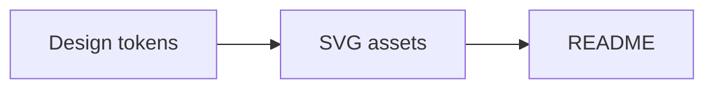

<!-- Copy this file to README.md and the SVGs you use to .github/assets/ (make them with: node make.mjs --title "..." --subtitle "..." --out .github/assets). -->
<p align="right">
  <picture>
    <source media="(prefers-color-scheme: dark)" srcset="https://raw.githubusercontent.com/belikh/design/main/packages/graphics/logo/jupiter-logo-dark.svg">
    
  </picture>
</p>

<p align="center">
  
  
</p>

> [!NOTE]
> One sentence on what this is and who it is for.

## Quick start

```sh
npm install project-name
```

<picture>
  <source media="(prefers-color-scheme: dark)" srcset=".github/assets/divider-dark.svg">
  
</picture>

## Status

| Area | State |
| --- | --- |
| API | stable |
| CLI | beta |

> [!WARNING]
> Call out anything that can bite.

## Architecture



Inline maths works too: $E = mc^2$. Brand colours render as chips: `#4b3fbf`.

## Licence

See [LICENSE](LICENSE).
