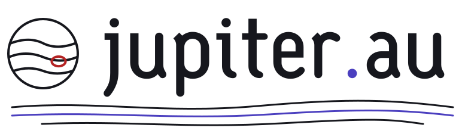

<!-- Organisation profile: .github/profile/README.md in the org's public `.github` repository (shown on github.com/<org>).
     Relative image paths are unreliable there, so use absolute raw URLs. Replace <org> and the branch if it is not main.
     Keep the SVGs in profile/assets/ of the same repo. -->

  <picture>
    <source media="(prefers-color-scheme: dark)" srcset="https://raw.githubusercontent.com/belikh/design/main/packages/graphics/logo/jupiter-logo-dark.svg">
    
  </picture>

## What we do

Two sentences about the organisation.

| Project | What it is | Status |
| --- | --- | --- |
| [project-one](https://github.com/<org>/project-one) | The main product | /.github/main/profile/assets/badge-ok-light.svg"> |
| [project-two](https://github.com/<org>/project-two) | The experiment | /.github/main/profile/assets/badge-info-light.svg"> |

> [!IMPORTANT]
> Read the [contributing guide](https://github.com/<org>/.github/blob/main/CONTRIBUTING.md) before opening a pull request.

<picture>
  <source media="(prefers-color-scheme: dark)" srcset="https://raw.githubusercontent.com/<org>/.github/main/profile/assets/divider-dark.svg">
  /.github/main/profile/assets/divider-light.svg" width="100%">
</picture>

[Website](https://example.com) · [Security policy](https://github.com/<org>/.github/security/policy)
